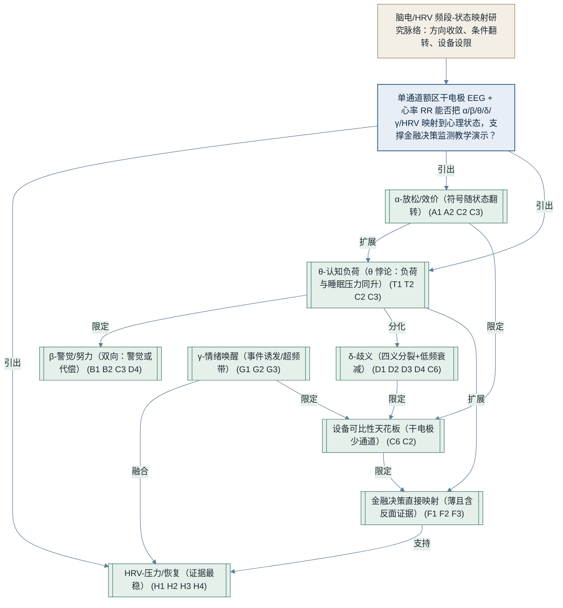

# 脑机接口数据在金融实践中的应用：频段-状态映射"方向有共识、解读有条件、设备有天花板"

> 脑机接口选修课 5 人小组项目（组长 E 统筹）；设备口径 BrainLink 单通道额区干电极 EEG + 心率 RR。本文件为提交版：正文一~八章 ≤2000 字；完整证据（表1/表2、C1–C10 矛盾清单、26 卡总表、参考稿）见附件 1–3，完整论证见同名《…_完整版存档》。本综述仅服务教学演示与机理探索，不作医学诊断外推。

## 一、核心结论

**总体判断**：用 BrainLink 单通道额区干电极 EEG 加心率 RR，把 α/β/θ/δ/γ 与 HRV 六维映射到情绪、压力、专注、疲劳并支撑金融演示，答案是**有条件可行**：六维在"频段功率→心理状态"方向上存在跨独立来源的收敛共识，但几乎每条方向都附带随状态翻转的条件，且证据几乎全部来自多通道湿电极、实验室、被试内口径，与单通道额区干电极隔着可量化但不可消除的设备鸿沟。

1. **HRV-压力/放松恢复**证据最扎实：三条系统综述/Meta（Zou 2018；Goessl 2017；Laborde 2022）与 TSST 急性压力实验（Engert 2016）收敛于副交感升高=放松恢复；须区分静态基线 HRV 与动态应激-恢复轨迹。
2. **额区 α↑**可靠指向放松/觉醒降，但符号随状态翻转（认知投入时 ERD↓），额区 α-效价一对一映射跨研究不成立；后部 α 采不到，仅可用额区相对变化近似。
3. **额-中线 θ↑**稳健指向认知负荷，但同时是睡眠压力标记——"θ 悖论"（Snipes 2022）使 θ 单值不可解读，须用 θ/β、β/(θ+α) 比值消歧。
4. **β↑**指向警觉/努力，但双向：长任务中可代偿性升高（Ismail 2020；Craig 2012），须绑定任务时长；工程优先 β/(θ+α)。
5. **δ**含义四分（内注意/嗜睡局灶/夜间稳态/疲劳无变化），且干电极对 <4 Hz 衰减最重（Zhang 2025），仅作绑定情境的探索项。
6. **γ**与情绪唤醒相关，但是事件诱发、位于后区、46–65 Hz 超设备频带，仅作机理背景；可借"RR 波动+可测频段"的脑-心耦合思路（Fusina 2025）。
7. **金融直接实证仅 3 篇**（Gehring 2002；Tripathi 2023；Kwak 2025），其中 1 篇为 N=10 反面小样本；~85% 为多通道湿电极被试内数字，FRN 单通道不可提取，勿把频段功率等同冒险倾向。

**落到模拟程序假设**：可支撑——①HRV/RR→压力放松；②额区 α→放松/觉醒降（双向口径）；③θ/β、β/(θ+α)→认知负荷；④β→警觉（绑定时长）。仅作探索——δ 单值、γ、θ 单值。

## 二、研究范围与方法

经 Google Scholar/PubMed 网络镜像主题检索，再经 CrossRef/DOI 与原期刊页逐条核对，纳入 26 条（**VERIFIED 26 + MINOR 0**，2026-10-12 复核后原 3 条 MINOR 已补全 DOI 升级）。证据分级：Ⅰ=系统综述/Meta/N≥50 对照；Ⅱ=20≤N<50；Ⅲ=N<20/侵入式/科普。关键勘误与复核留痕见文末"修订记录"，全表核验状态见附件 2。

## 三、文献多维地图

证据高度集中在 HRV 与 θ/α/β 的认知-情绪映射且方向收敛；δ、γ 在"消费级额区设备"口径下接近空白（属真空白而非检索遗漏）；金融直接实证最稀疏（3 篇）。完整八主题密度表（表1）与六维映射证据汇总（表2，每行 ≥3 条可溯源文献）见附件 1。

## 四、核心逻辑图

## 五、主题章节（压缩版）

**（一）α-放松/效价**：正念类综述最一致伴 α+θ 共升（Lomas 2015；Lagopoulos 2009），额区 α 不对称编码效价 75–85%（Gkintoni 2025）；但负荷时后部 α 下降（Ismail 2020；Petrović 2026），符号翻转。小结：α-放松可入假设，须声明双向口径。

**（二）β-警觉/努力**：警觉升高伴 β 激活（Kamiński 2012），高表现者前区 β 多（Valentino 1993）；但长任务中 β 代偿性升高（Ismail 2020 §4.1.3；Craig 2012）。小结：β 须绑定任务时长，优先 β/(θ+α)。

**（三）θ-认知负荷与悖论**：fmθ 随负荷线性升 r=0.65–0.85（Gkintoni 2025；Mitchell 2008），"额 θ↑+顶 α↓"为领域共识；但睡眠剥夺同升内侧前额 θ（Snipes 2022）。小结：用 θ/β、β/(θ+α) 与设备"专注度"互证。

**（四）δ-歧义与设备衰减**：清醒 δ 至少四义（Harmony 2013；Slater 2017；Van Dongen 2003；Craig 2012 阴性），干电极对 <4 Hz 衰减最重。小结：仅机理探索，不作主假设。

**（五）γ-情绪唤醒**：晚期高 γ 对高唤醒图片增强且右侧优势（Keil 2001），但为逐事件诱发非持续状态（Luther 2023），46–65 Hz 超设备频带。小结：仅机理背景，借"RR+可测频段"脑-心耦合思路。

**（六）HRV-压力/恢复**：17 项 RCT 身心运动后 HFn↑/压力↓（Zou 2018）；生物反馈减压（Goessl 2017）；223 研究慢呼吸升迷走 HRV（Laborde 2022）；TSST 压力期抑制-恢复期回升（Engert 2016）。小结：可作主假设，区分基线/轨迹口径。

**（七）设备可比性**：少通道干电极被试内 80–90%（Muse 4ch 85.01%、IMEC 8ch 被试内二分类 71.7±15.5%），跨被试低 10–15%、低频衰减、噪声 +30–40%（Zhang 2025）。结论：BrainLink 可做粗粒度被试内演示，精度按文献口径标注。

**（八）金融映射**：FRN 机理（Gehring 2002）作底料；交易模拟情绪分类 85.65%/85.05%、风控改变情绪分布（Tripathi 2023）；N=10 显示脑波不直接预测冒险（Kwak 2025）。结论：演示"标准化诱发→EEG/RR 同步→效价-唤醒/压力轨迹反馈"，不外推投资建议。

## 六、争议与开放问题

C1–C10 矛盾清单（β 双向、α 符号翻转、δ 四分、θ 悖论、干湿等效性、IMEC 口径、HRV 口径等）全表见附件 1。开放空白：①单通道额区金融实时压力下的 HRV/频段轨迹实证空白；②θ 悖论在消费设备的自动消歧缺失；③额区 α 替代后部 α 效度未验证；④公开数据集仍沿用 DEAP。

## 七、可研究的方向

优先 1–2（"少有人做×现有设备做得动"）：①《标准化模拟交易任务中用单通道额区干电极 EEG+心率 RR 复现 HRV 应激-恢复轨迹与 θ/β 比值变化》；②《用 θ/β 与 β/(θ+α) 比值结合任务时长区分认知负荷与困倦》。拓展 3–4 需多通道对照设备（额区 α 替代效度、干湿电极一致性对照）。

## 八、局限性

课程定位：教学演示与机理探索，不作临床或消费设备效度认证，所有方向性关系属待检验假设。证据层面：金融直接实证仅 3 篇且含 1 篇 N=10 反面；δ/γ 在单通道额区口径下接近不可测；多条核心数字来自综述/Meta 跨研究归纳、精度需打折；部分文献为摘要/卡面级解读，未读原文处不补精确数字。设备层面：单通道额区干电极与多通道湿电极在通道数、空间定位、低频保真、跨被试一致性上均有可量化差距，所有准确率/效应量按文献原始口径标注、不代表本设备可复现水平。

## 修订记录（2026-10-12 P0 复核，不计入正文字数）

- **P0-1 IMEC 71.7%**：回 Zhang 2025 §3.1 正文 + Table 2 [82] 核实为被试内二分类（dry 71.7±15.5%/wet 70.3±22.5%），声明属实。
- **P0-2 DOI 复核**：Goessl=10.1017/S0033291717001003（原候选证伪）、Lomas=10.1016/j.neubiorev.2015.09.018（原候选证伪）、Laborde 文章号 104886→104711、Slater 期刊勘误 J Neuropsychiatry Clin Neurosci 29(3):236-247、Craig 页码 49(4):574-582、Valentino 由 PubMed 补 DOI、Kwak 年份更正为 2025、Lagopoulos/Mitchell/Tripathi 补全。VERIFIED 23+3 → **26+0**。

## 九、参考文献（26 条，不计入正文字数）

Rahman et al.（2021），Computers in Biology and Medicine, 136:104696。DOI: 10.1016/j.compbiomed.2021.104696；PMID: 34388471。 [原文/DOI 链接](https://pubmed.ncbi.nlm.nih.gov/34388471/)

Gkintoni 和 Halkiopoulos（2025），Biomimetics (Basel), 10(11):730。DOI: 10.3390/biomimetics10110730；PMID: 41294401。 [原文/DOI 链接](https://pubmed.ncbi.nlm.nih.gov/41294401/)

Ismail 和 Karwowski（2020），PLoS ONE, 15(12):e0242857。DOI: 10.1371/journal.pone.0242857；PMID: 33275632。 [原文/DOI 链接](https://pubmed.ncbi.nlm.nih.gov/33275632/)

Koelstra et al.（2012），IEEE Transactions on Affective Computing, 3(1):18-31。DOI: 10.1109/T-AFFC.2011.15。 [原文/DOI 链接](https://ieeexplore.ieee.org/document/6047007)

Petrović（2026），Medical Sciences Forum, 46(1):8。DOI: 10.3390/msf2026046008。 [原文/DOI 链接](https://www.mdpi.com/2571-9772/46/1/8)

Zhang et al.（2025），Sensors, 25(16):5215。DOI: 10.3390/s25165215。 [原文/DOI 链接](https://www.mdpi.com/1424-8220/25/16/5215)

Harmony（2013），Frontiers in Integrative Neuroscience, 7:83。DOI: 10.3389/fnint.2013.00083。 [原文/DOI 链接](https://www.frontiersin.org/articles/10.3389/fnint.2013.00083/)

Van Dongen et al.（2003），SLEEP, 26(2):117-126。DOI: 10.1093/sleep/26.2.117。 [原文/DOI 链接](https://academic.oup.com/sleep/article/26/2/117/2709618)

Slater et al.（2017），Journal of Neuropsychiatry and Clinical Neurosciences, 29(3):236-247。DOI: 10.1176/appi.neuropsych.16060120；PMID: 28121257。 [原文/DOI 链接](https://neuro.psychiatryonline.org/doi/10.1176/appi.neuropsych.16060120)

Craig et al.（2012），Psychophysiology, 49(4):574-582。DOI: 10.1111/j.1469-8986.2011.01329.x。 [原文/DOI 链接](https://onlinelibrary.wiley.com/doi/10.1111/j.1469-8986.2011.01329.x)

Zou et al.（2018），Journal of Clinical Medicine, 7(11):404。DOI: 10.3390/jcm7110404；PMID: 30384420。 [原文/DOI 链接](https://pubmed.ncbi.nlm.nih.gov/30384420/)

Goessl et al.（2017），Psychological Medicine, 47(15):2578-2586。DOI: 10.1017/S0033291717001003。 [原文/DOI 链接](https://www.cambridge.org/core/journals/psychological-medicine/article/effect-of-heart-rate-variability-biofeedback-training-on-stress-and-anxiety-a-metaanalysis/)

Laborde et al.（2022），Neuroscience and Biobehavioral Reviews, 138:104711。DOI: 10.1016/j.neubiorev.2022.104711。 [原文/DOI 链接](https://hal.science/hal-04925897)

Engert et al.（2016），Psychoneuroendocrinology, 74:111-120。DOI: 10.1016/j.psyneuen.2016.08.029；PMID: 27608360。 [原文/DOI 链接](https://pubmed.ncbi.nlm.nih.gov/27608360/)

Keil et al.（2001），Clinical Neurophysiology, 112(11):2057-2068。DOI: 10.1016/S1388-2457(01)00654-9；PMID: 11682344。 [原文/DOI 链接](https://pubmed.ncbi.nlm.nih.gov/11682344/)

Luther et al.（2023），Frontiers in Human Neuroscience, 16:868549。DOI: 10.3389/fnhum.2022.868549；PMID: 36741785。 [原文/DOI 链接](https://pubmed.ncbi.nlm.nih.gov/36741785/)

Fusina et al.（2025），Frontiers in Neuroscience, 19:1599349。DOI: 10.3389/fnins.2025.1599349。 [原文/DOI 链接](https://www.frontiersin.org/articles/10.3389/fnins.2025.1599349/)

Lomas et al.（2015），Neuroscience and Biobehavioral Reviews, 57:401-410。DOI: 10.1016/j.neubiorev.2015.09.018。 [原文/DOI 链接](https://doi.org/10.1016/j.neubiorev.2015.09.018)

Lagopoulos et al.（2009），Journal of Alternative and Complementary Medicine, 15(11):1187-1192。DOI: 10.1089/acm.2009.0113。 [原文/DOI 链接](https://www.liebertpub.com/doi/10.1089/acm.2009.0113)

Kamiński et al.（2012），International Journal of Psychophysiology, 85(1):125-128。DOI: 10.1016/j.ijpsycho.2011.11.006。 [原文/DOI 链接](https://www.sciencedirect.com/science/article/abs/pii/S0167876011002216)

Valentino et al.（1993），International Journal of Psychophysiology, 15(2):123-133。DOI: 10.1016/0167-8760(93)90070-6；PMID: 8244840。 [原文/DOI 链接](https://pubmed.ncbi.nlm.nih.gov/8244840/)

Snipes et al.（2022），The Journal of Neuroscience, 42(50):9473-9488。DOI: 10.1523/JNEUROSCI.1063-22.2022。 [原文/DOI 链接](https://www.jneurosci.org/content/42/50/9473)

Mitchell et al.（2008），Progress in Neurobiology, 86(3):156-185。DOI: 10.1016/j.pneurobio.2008.09.005。 [原文/DOI 链接](https://doi.org/10.1016/j.pneurobio.2008.09.005)

Gehring 和 Willoughby（2002），Science, 295(5563):2279-2282。DOI: 10.1126/science.1065374。 [原文/DOI 链接](http://saki.caltech.edu/biCNS217_2008/PDFs/Gehring2002.pdf)

Tripathi 和 Sharma（2023），Sensors (Basel), 23(7):3474。DOI: 10.3390/s23073474；PMID: 37050533。 [原文/DOI 链接](https://pmc.ncbi.nlm.nih.gov/articles/PMC10098917/)

Kwak 和 Grable（2025），Journal of Gambling Issues。DOI: 10.4309/WZXX6075。 [原文/DOI 链接](https://cdspress.ca/?p=11280)
