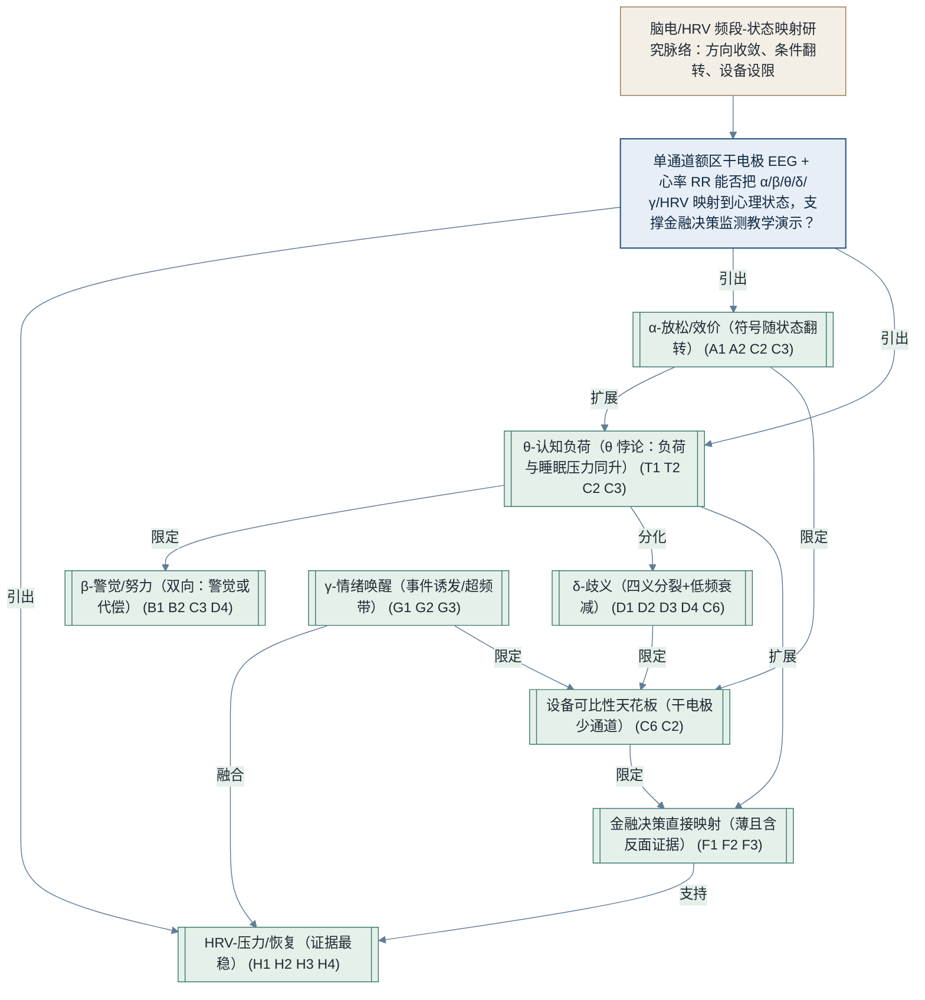

# 脑机接口数据在金融实践中的应用：频段-状态映射"方向有共识、解读有条件、设备有天花板"

> 脑机接口选修课 5 人小组项目（组长 E 统筹）；设备口径 BrainLink 单通道额区干电极 EEG + 心率 RR。本文为文献调研与证据支撑结果，服务金融决策场景（情绪/压力/专注/疲劳监测）的教学演示与机理探索；不作医学诊断类外推。

## 一、核心结论

**总体判断**：本项目要回答的核心问题是——能否用 BrainLink 单通道额区干电极 EEG 加心率 RR，把 α/β/θ/δ/γ 与 HRV 六个数据维度映射到情绪、压力、专注、疲劳四类心理状态，并支撑一个金融决策监测的教学演示。证据给出的答案是**有条件可行**：六个维度在"频段功率→心理状态"的方向上存在跨独立来源的收敛共识，但几乎每个方向都附带一个随状态翻转的条件；更关键的是，这批证据几乎全部建立在多通道湿电极、实验室、被试内离线条件上，与 BrainLink 的单通道额区干电极口径之间隔着一条可量化但不可消除的设备鸿沟。因此本项目可稳妥地把 HRV/心率 RR、额区 α-放松、θ/β 与 β/(θ+α) 比值、β-警觉这几条方向写进模拟程序假设；而 δ、γ 以及 θ 的单值读数必须绑定任务情境、或仅作机理探索。当前证据最薄弱的环节是三处：δ 频带在干电极上物理衰减最重且含义四分、γ 频带超出消费设备有效范围、以及金融场景的直接实证仅 3 篇且其中 1 篇为反面小样本证据。

1. **HRV（尤其 HF/迷走成分）与"压力下降/放松恢复"的关联是六个维度中证据最扎实的一条**，可被三条系统综述/Meta 与一项大样本急性压力实验交叉证实：身心运动类 RCT Meta 显示 HFn 升高、LF/HF 下降、主观压力下降（Zou et al.，2018），HRV 生物反馈训练与压力焦虑大幅下降相关（Goessl et al.，2017），主动慢呼吸在过程中、单次后与多次干预后均升高迷走 HRV（Laborde et al.，2022），TSST 急性压力下 HF-HRV 呈"压力期被抑制、恢复期快速回升"的轨迹（Engert et al.，2016）。**边界**：静态基线 HRV（反映特质/恢复力）与动态应激-恢复轨迹是两种不同读数；消费级 RR 序列长度与呼吸控制未标准化，绝对 HF/LF 数值不可外推。

2. **额区/全域 α 功率升高可靠指向放松与觉醒下降，但 α 的符号随状态翻转，不可单向解读**：正念类系统综述最一致地观察到 α 与 θ 共升，被解释为"放松而警觉"（Lomas et al.，2015；Lagopoulos et al.，2009），额区 α 不对称编码情绪效价在 DEAP 上可达 75–85%（Gkintoni and Halkiopoulos，2025）；但同一批综述也记录认知负荷/工作记忆时顶枕 α 下降（ERD）（Ismail and Karwowski，2020；Petrović，2026）。**边界**：经典"顶/枕 α↓=负荷"依赖后部导联，BrainLink 单通道额区采不到后部 α，只能用额区 α 的相对变化作近似；同文亦承认额区 α-效价的一对一跨研究映射并不成立（Gkintoni and Halkiopoulos，2025 §8.3）。

3. **额-中线 θ 升高稳健指向认知控制/工作记忆负荷，但它同时是睡眠压力的标记——"θ 悖论"决定了 θ 单值不可解读**：额中线 θ 随工作记忆负荷线性上升（跨研究 r=0.65–0.85）（Gkintoni and Halkiopoulos，2025；Mitchell et al.，2008），"额区 θ↑ + 顶区 α↓"是认知负荷升高的领域共识（Ismail and Karwowski，2020；Petrović，2026）；但睡眠剥夺与认知负荷同样升高内侧前额 θ（Snipes et al.，2022）。**边界**：θ 升高到底是"努力专注"还是"困倦"必须结合任务时长与情境判断，不能单靠 θ 数值给状态下定论。

4. **β 升高指向警觉/努力，但方向是双向的——它也可能是对抗疲劳的代偿**：警觉度升高伴随 β 激活增强（Kamiński et al.，2012），高作业表现者前区 β 更多、颞区 β 下降是作业滑坡的最佳指标（Valentino et al.，1993）；但长时间任务中枕区/外侧额叶 β 反而升高，被解释为"为保持清醒付出的额外努力"（Ismail and Karwowski，2020 §4.1.3），清醒模拟驾驶疲劳时额区 β 也显著升高（Craig et al.，2012）。**边界**：β-专注这一行必须绑定任务时长，β↑ 既可能是真警觉也可能是抗疲劳代偿。

5. **δ 是六个维度中含义最分裂、且在本设备上物理上最不可靠的一条，只能降级为"绑定情境的探索项"**：清醒内指向注意/抑制时额区 δ 升高（Harmony，2013）、嗜睡期局灶 δ 岛标志局部睡眠（Slater et al.，2017）、NREM δ 是睡眠稳态指标（Van Dongen et al.，2003），但清醒任务疲劳中 δ 并无显著变化（Craig et al.，2012）。**边界**：四个"δ 升高"对应四种不同状态；更要命的是干电极对 <4 Hz 的 δ/θ 低频衰减最重（Zhang et al.，2025），BrainLink 的 δ 读数在物理层面就最不干净。

6. **γ 与情绪唤醒相关，但它是事件诱发的瞬时反应、位于后区、且频带超出消费设备能力——对 BrainLink 只能作机理背景，不能作设备端读数**：晚期高 γ（46–65 Hz）对高唤醒图片增强且右侧优势（Keil et al.，2001），负性图片引起后区 γ↑/α↓ 且证明是"逐事件诱发而非持续状态"（Luther et al.，2023），高情绪调节困难个体中 γ 与腹侧注意网络的心率连接增强（Fusina et al.，2025）。**边界**：γ 频带与额区单通道空间位置双双不匹配，不可复现；Fusina 的脑-心耦合结果提示项目可改用"RR 波动 + 频段功率"做粗粒度映射，而非直接测 γ。

7. **金融决策场景的直接实证薄、且需防过度外推**：损失反馈诱发更大内侧前额负波 FRN、损失后更冒险（Gehring and Willoughby，2002），交易模拟中 EEG 情绪分类约 85% 且风险控制组情绪分布更偏正性（Tripathi and Sharma，2023）；但小样本研究显示脑波并不直接预测单次冒险行为，更多标记风险态度本身（Kwak and Grable，2025）。**边界**：~85% 是多通道湿电极被试内离线数字，FRN 是事件锁定 ERP、单通道不可提取；勿把频段功率直接等同于"冒险倾向"。

### 映射关系表结论并入（2026-10-15）

**六维映射一句话口径**（引用《脑波-心率与状态映射关系表_组长E_20261015.md》"五、结论一句话口径"）：BrainLink 单通道额区干电极 + 心率 RR 可支撑的映射为：HRV/RR→压力放松（主假设）、额区 α 相对升降→放松/注意投入（双向口径）、θ/β 与 β/(θ+α) 比值→认知负荷/专注（主口径）、额区 θ→觉醒期疲劳（绑定任务时长）；δ、γ 与 FAA 仅作机理背景或探索项，所有方向性关系为待检验假设、仅用于教学演示，准确率/效应量按文献原始口径标注、不代表本设备可复现水平。

**M13 决议（2026-10-15 组长拍板）**：专注度主口径=θ/β 比值（案A，SDK 文档佐证）；α↓ 与 β↑ 仅作交叉佐证，不作单频段一刀切。

**边界声明**：①归一化显示值（专注度/放松度 0–100）仅用于比值与趋势，不代入绝对百分比；②额区单通道限定——后部 α、γ、FRN 等不可测项不进入假设；③真机到手后须复核模拟数据与真机数据口径一致性。

**矛盾点 M1–M13 一句话概括**：M1 β 双向（β↑=警觉或抗疲劳代偿，绑定任务时长）；M2 α 符号翻转（放松↑ vs 注意投入↓）；M3 δ 四分（内注意/嗜睡局灶/夜间稳态/疲劳无变化）；M4 θ 悖论（负荷与睡眠压力同升，靠比值消歧）；M5 疲劳 θ↑ vs 嗜睡 θ↓（先分行为/场景）；M6 干湿电极等效仅窄口径成立；M7 IMEC 71.7% 为被试内二分类；M8 γ 空间/频带超设备（仅机理）；M9 HRV 基线 vs 轨迹须区分；M10 消费设备 HRV 限静坐演示；M11 频段功率≠风险倾向；M12 FAA 单通道不可算（仅答辩示例）；M13 专注主导权已决议 θ/β 主口径、α↓/β↑ 佐证。

（引用：《脑波-心率与状态映射关系表_组长E_20261015.md》《M13专注度主导权_决议记录_组长E_20261015.md》）

## 二、研究范围与方法

**检索策略**：本轮为课程项目文献调研，通过 Google Scholar / PubMed 网络镜像做主题检索，再经 CrossRef/DOI 解析与原期刊页（Cambridge/Elsevier/MDPI/Oxford/Wiley/Frontiers/CDS Press）逐条核对。检索视角覆盖五路：①频段-状态映射主流方（α/β/θ/δ/γ 各频段与情绪/认知负荷/疲劳）；②HRV 压力/放松机制；③设备与硬件可比性（干电极、消费级 BCI）；④金融/经济决策直接实证（神经金融、交易 EEG）；⑤反面与限定证据（阴性结果、悖论、小样本 caution）。关键检索式包括 "delta wave awake fatigue sleepiness"、"heart rate variability stress emotion meta-analysis"、"gamma emotional arousal"、"theta beta sustained attention"、"EEG financial decision trading risk"、"dry electrode BCI review" 等（完整检索记录见组长 E 两份检索底稿）。

**纳入标准**：与"频段/HRV→心理状态"映射直接相关、题名+第一作者+期刊+年份可核验、优先系统综述/Meta 与 N≥50 对照实验、兼顾与项目人群（健康大学生）接近的样本。**排除标准**：无法核验题名/作者/期刊一致性的灰区文献一律不纳入；厂商白皮书/营销资料不作证据条目；纯临床病理（癫痫病灶定位、睡眠障碍诊断）仅在提供机理方向时降级引用。

**文献数量与证据分级**：经核验纳入 26 条（VERIFIED 26 条、MINOR 0 条——原 3 条 MINOR 已于 2026-10-12 复核补全 DOI 与卷期页码，全部升级为 VERIFIED）。证据强度按项目工具包三级标注：**Ⅰ=系统综述/Meta/大样本 N≥50 对照实验**；**Ⅱ=单中心小样本（20≤N<50）或高质量预印本/会议综述**；**Ⅲ=小样本 N<20/侵入式患者样本/科普性综述**。这一分级与"研究设计层级 × 学科内适配度"双轴一致：人文与认知神经科学的小样本高被引奠基作（如 Keil et al.，2001）不因非 RCT 而被压成"无效"，而是如实标为 Ⅲ 级机理证据。其中 12 条为核心文献（source_quality A/B，含 DEAP、FRN 两篇奠基作），均有正向质量凭据（顶刊/高被引/经典奠基）。

**关键勘误**：Zou et al.（2018）原卡面误作 J Clin Med 7(11):375，已据 PubMed 更正为 **7(11):404，DOI 10.3390/jcm7110404**；Gkintoni & Halkiopoulos（2025）期刊勘误为 Biomimetics 而非 Brain Sciences；IMEC 8 通道干电极情绪二分类 71.7% 已回 Zhang et al.（2025）§3.1+Table 2 核实为被试内二分类数字。**2026-10-12 DOI 复核**：Goessl 2017 正确 DOI 为 10.1017/S0033291717001003（原候选 …1763 证伪改正）、Lomas 2015 为 10.1016/j.neubiorev.2015.09.018（原候选 .09.023 证伪改正）、Laborde 2022 为 NBR 138:104711 / DOI 10.1016/j.neubiorev.2022.104711（原 104886 更正）、Slater 2017 期刊勘误为 J Neuropsychiatry Clin Neurosci 29(3):236-247（DOI 10.1176/appi.neuropsych.16060120）、Craig 2012 页码更正为 49(4):574-582（DOI 10.1111/j.1469-8986.2011.01329.x）、Kwak & Grable 正式刊出年份为 2025（DOI 10.4309/WZXX6075）。

## 三、文献多维地图

表 1：八个主题方向的证据密度、代表文献、争议与空白（代表编号对应第十节阅读卡 evidence_id）

| 主题 | 支持文献数 | 代表文献 | 争议 / 反对 | 研究空白 / 后续价值 |
|---|---:|---|---|---|
| A. HRV-压力/放松恢复 | 4 篇 | H1 H2 H3 H4 | 基本无方向争议，仅基线 vs 应激恢复口径需区分 | 消费级 RR 在金融实时压力场景的动态轨迹验证不足 |
| B. θ-认知负荷与悖论 | 5 篇 | T1 T2 C2 C3 C5 | θ 同时标记认知控制与睡眠压力（θ 悖论） | 单通道额区如何结合任务时长区分两种 θ |
| C. α-放松/效价 | 4 篇 | A1 A2 C2 C3 | α 符号随状态翻转；额区 α-效价跨研究不一致 | 额区 α 近似替代后部 α 的效度未在单通道验证 |
| D. β-警觉/努力（双向） | 4 篇 | B1 B2 C3 D4 | β 既=警觉也=抗疲劳代偿 | β 方向需绑定任务时长的判定阈值缺失 |
| E. δ-歧义与设备衰减 | 5 篇 | D1 D2 D3 D4 C6 | 清醒 δ 四义分裂；疲劳中 δ 阴性；干电极低频衰减 | δ 在消费级额区设备的可测性本身存疑 |
| F. γ-情绪唤醒（事件/超频带） | 3 篇 | G1 G2 G3 | γ 是事件诱发非状态；后区效应 | 单通道额区无法复现，仅脑-心耦合思路可迁移 |
| G. 消费级/干电极设备天花板 | 2 篇（含转引） | C6 C2 | 受控被试内干≈湿 vs 跨被试/真实场景掉 10–15% | 缺标准化评测基准、缺单通道消费设备效度研究 |
| H. 金融决策直接映射 | 3 篇 | F1 F2 F3 | F3 反面小样本：脑波不直接预测单次冒险 | 交易真实压力下 EEG+RR 同步监测的实证稀缺 |

整体分布：证据高度集中在 HRV 与 θ/α/β 的认知-情绪映射，且方向收敛；δ 与 γ 两个频带在"消费级额区设备"这一特定口径下接近空白——这不是没搜到，而是该口径下本来就难以成立，属真空白；金融直接实证是最稀疏的应用层格子，仅有 3 篇、且证据强度参差。

## 四、研究视角与本文结构

本文的分类轴是**数据维度（频段/外周信号）→心理状态**，而非按论文罗列。之所以这样切分，是因为本项目的工程对象是 BrainLink 输出的六个可测量，读者最需要知道的是"每一个量背后证据有多少、往哪个方向指、在哪种条件下会翻"。八个主题满足 MECE：前六个（α/β/θ/δ/γ/HRV）按信号维度互斥切分、合起来覆盖全部六个可测量；第七节设备可比性是横跨所有频段的"元约束"，单独成节；第八节金融映射是把前述证据落到项目应用场景的合成节，不与单频段节重叠。

下文"六、主题章节"先逐维展开（一）至（六），每节按"claim→正面证据→反面/限定→条件差异→跨主题连接"组织；随后（七）把六维压缩成一张映射关系表，直接给出哪些可写进模拟程序假设；（八）诚实评估 BrainLink 与多通道湿电极的可比性边界；（九）落到金融决策场景的机会与风险。各主题的 claim 即第一节核心结论第 1–7 条，其证据节点即第三节地图与第五节逻辑图的对应对象。

## 五、核心逻辑图

（本图在飞书文档中以白板呈现）

## 六、主题章节

### （一）α 波与放松/平静

*本节文献：Lomas et al.（2015）、Lagopoulos et al.（2009）、Gkintoni and Halkiopoulos（2025）、Ismail and Karwowski（2020）、Petrović（2026）*

**claim**：α 功率升高在"脱离/放松/觉醒下降"情境下方向稳健，但它是一个**符号随状态翻转**的指标——放松时升、认知投入时降，因此 α 只能在给定状态语境下解读。

正面证据高度收敛于放松情境：正念类研究最一致地观察到 α 与 θ 共升，Lomas et al.（2015）汇总 56 篇、1715 人后认为这对应"放松而警觉"（relaxed alertness）；Lagopoulos et al.（2009）在被试内对照中复现了非引导冥想相对安静休息的 θ（额颞区）与 α（后区）升高。这两项与 Gkintoni and Halkiopoulos（2025）给出的额区 α 不对称编码效价（DEAP 上二元效价 75–85%）方向互证：α 的相对高低与效价/放松状态相关联。

但反面与限定同样清晰。其一，**α 的符号会翻转**：Ismail and Karwowski（2020）系统综述 143 项研究后确立的认知负荷方向恰恰是"额区 θ↑ + 顶区 α↓"，Petrović（2026）在健康大学生中重复了这一"后部 α↓=高负荷"——也就是说，同一个 α 指标，在放松态升高、在加工态下降，二者并不矛盾而是两种状态。其二，**额区 α-效价的一对一映射并不成立**：Gkintoni and Halkiopoulos（2025）在 §8.3 明确警告，额区 α 不对称与效价的关系跨研究并不一致，个体 α 峰频（7–14 Hz）差异与情绪框架不统一是主因——摘要里的乐观准确率与正文里的告诫必须同时引用。

条件差异上，放松 α 多以后部（顶/枕）为主，而 BrainLink 是额区单通道，**采不到后部 α**；文献中"顶/枕 α↓=负荷"的经典结论无法直接在额区复现，本项目只能用额区 α 的相对变化作粗近似（Gkintoni and Halkiopoulos，2025 §2.1 亦指出头皮 EEG 空间分辨仅 2–3 cm）。跨主题连接上，α 与 θ 在冥想中"共升"（A1/A2）正是下一节 θ 与放松/负荷双重身份的入口。

> **小结**：α-放松方向可写进模拟程序假设，但必须同时声明"α↑=放松/觉醒降、α↓=注意投入"的双向口径，且因设备为额区单通道，后部 α 效应不可外推。

### （二）β 波与专注/警觉

*本节文献：Kamiński et al.（2012）、Valentino et al.（1993）、Ismail and Karwowski（2020）、Craig et al.（2012）、Gkintoni and Halkiopoulos（2025）*

**claim**：β 升高指向警觉与努力性唤醒，但它是**双向**的——既可以是真警觉，也可以是对抗疲劳的代偿性努力；β 方向必须绑定任务时长判断。

正面证据：Gkintoni and Halkiopoulos（2025）把唤醒度与广泛 β/γ 功率变化相连；Kamiński et al.（2012）在预期注意/视觉反应时范式中观察到警觉度升高伴随 β 激活增强；Valentino et al.（1993，N=54）把警觉任务中保持高表现者（HiVig）与作业滑坡者（LoVig）分组后发现，高表现者前区 β 更多、而后区 α/θ 更少，颞区 β 下降正是作业滑坡的最佳指标——这条把"前区 β 多=维持警觉表现好"坐实，且与 BrainLink 额区口径可比。

反面/限定是关键的双向性：Ismail and Karwowski（2020 §4.1.3）在系统综述中专门记录了一个反例——长时间任务中枕区/外侧额叶 β 不随疲劳下降反而升高，作者引 Lafrance & Dumont 等将其解释为"为保持清醒而付出的额外努力（代偿）"；Craig et al.（2012，N=48）在模拟驾驶疲劳中同样观察到全皮层慢波（θ/α）升高的同时额区 β 显著升高，解释为"脑变慢"却在"努力维持警觉"。两篇独立来源指向同一现象：**β↑ 不等于状态更好，也可能是疲劳边缘的挣扎**。

条件差异：β（13–30 Hz）落在消费级额区设备有效频带内，口径可比；问题不在测不到，而在单向解读会误判。跨主题连接上，β 的代偿性升高与第四节 δ/θ 的疲劳慢波升高是同一"疲劳维持警觉"故事的两面，也解释了为何 Ismail and Karwowski（2020）推荐用比值 β/(θ+α)（投入度指数）而非单看 β。

> **小结**：β-警觉方向可入假设，但必须标注"β↑=警觉或抗疲劳代偿，需结合任务时长"；工程上优先用 β/(θ+α) 比值而非 β 单值。

### （三）θ 波与困倦/疲劳/记忆

*本节文献：Mitchell et al.（2008）、Gkintoni and Halkiopoulos（2025）、Ismail and Karwowski（2020）、Petrović（2026）、Snipes et al.（2022）*

**claim**：额-中线 θ（fmθ）升高稳健指向认知控制/工作记忆负荷，但它同时是睡眠压力的标记——"θ 悖论"决定了 θ 单值读数不可解读。

正面证据：Mitchell et al.（2008）从海马 θ 功能视角综述 fmθ，确认其与工作记忆、持续注意、记忆加工正相关；Gkintoni and Halkiopoulos（2025 §8.2）给出量化区间——fmθ 随工作记忆负荷线性上升，跨研究 r=0.65–0.85、高/低负荷 Cohen's d≈0.8–1.2；Ismail and Karwowski（2020）与 Petrović（2026）分别在 143 项研究与 7 项大学生研究中收敛到同一方向："额区 θ↑ + 后部 α↓"=认知负荷升高。三条独立证据链（机理综述、PRISMA 系统综述、大学生人群综述）在此收敛，方向可信度高。

反面/限定即"θ 悖论"：Snipes et al.（2022，N=18）在三种睡眠剥夺水平下完成六类认知任务，发现**认知负荷与睡眠剥夺都升高内侧前额 θ**，而睡眠剥夺还在更广额区升高 θ——即同一额区 θ 升高，在"努力专注"与"困倦"两种情境下方向相同、含义相反。这与第二节 β 的双向性叠加后，意味着单靠 EEG 频段功率同时分辨"专注/疲劳"在原理上就需要额外的情境信息。

条件差异上，fmθ 定位在额中线，**恰为 BrainLink 额区通道覆盖位置，是六维中口径最可比的一条**；但正因为它最可比，θ 悖论对项目的杀伤也最大——若把"θ↑"直接写成"专注↑"，会把困倦误判成专注。跨主题连接上，θ 与 δ 同属慢波、且都随疲劳/负荷变化，是第四节 δ 歧义的上游；θ/β 比值之所以稳健，正是因为它用 β 抵消了 θ 的双义。

> **小结**：θ-认知负荷方向可入假设，但 θ 单值必须绑定任务情境；工程上用 θ/β 或 β/(θ+α) 比值替代 θ 单值，与设备"专注度"字段互证。

### （四）δ 波与疲劳/嗜睡/恢复

*本节文献：Harmony（2013）、Van Dongen et al.（2003）、Slater et al.（2017）、Craig et al.（2012）、Zhang et al.（2025）*

**claim**：δ 是六维中含义最分裂、且在本设备上物理上最不可靠的一条；"清醒高 δ"至少对应四种不同状态，不能单向读作疲劳/嗜睡。

把四条证据并置即可见分裂：Harmony（2013）综述清醒态 δ，发现内指向注意/抑制（心算、Sternberg 工作记忆、No-Go）时额区 δ 升高，并提出 δ 通过"功能去传入"抑制无关感觉网络来服务内部集中；Van Dongen et al.（2003，N=48）确立 NREM 睡眠 δ 为睡眠稳态指标，长期清醒的睡眠债主要在恢复睡眠的 δ 反弹中体现（其 δ 证据来自夜间多导睡眠，不等同于清醒态额区 δ）；Slater et al.（2017，N=6 癫痫患者 ECoG）观察到清醒→嗜睡期出现局灶 δ"岛"、伴随局部神经元活动下降，把局灶 δ 升高读作嗜睡/局部睡眠；而 Craig et al.（2012，N=48）在清醒模拟驾驶疲劳中给出**阴性结果**——随疲劳进展升高的是 θ/α 慢波，δ 无显著变化。四者并不互相否定，而是说明"δ 升高"根本不是单一状态标记：内注意、嗜睡局灶、夜间恢复、疲劳中无变化，四种含义并存。Harmony（2013）还给出一个关键机理区分——清醒 δ 与内侧额叶代谢正相关、而睡眠慢波 δ 与代谢负相关，二者功能相反。

条件差异/设备约束是决定性的：Zhang et al.（2025 §4.1.1）明确指出干电极对 <4 Hz 的 δ/θ 低频衰减最重——也就是说，BrainLink 物理上最采不准的恰好是 δ。再叠加 δ 的含义分裂，这一维度只能降级为"绑定情境的探索项"，不可作为模拟程序的主假设。（注：原精读卡面"清醒超约 15.84 h 后失误近线性累积"这一阈值数字未回原文核验，按证据纪律不写入正文；仅保留"清醒行为警觉失误随清醒时长近似累积"这一方向性表述。）

跨主题连接上，δ 与 θ 同属慢波、共享干电极低频衰减问题，是第三节 θ 悖论的低频延伸；Petrović（2026 §1）亦注明"高认知需求时 δ 也可能升高"，进一步削弱单向映射。

> **小结**：δ 行标"部分一致/有歧义+设备物理局限"，仅作机理探索；不在模拟程序中把 δ 单值映射为疲劳/嗜睡。

### （五）γ 波与高级认知/情绪唤醒

*本节文献：Keil et al.（2001）、Luther et al.（2023）、Fusina et al.（2025）、Gkintoni and Halkiopoulos（2025）*

**claim**：γ 与情绪唤醒皮层加工相关，但它是**事件诱发的瞬时反应、位于后区、且频带超出消费设备能力**——对 BrainLink 只能作机理背景，不可作设备端状态读数。

正面证据：Keil et al.（2001，N=10，129 导）观察到厌恶负性刺激在约 80 ms 即增强早期中 γ（30–45 Hz），晚期高 γ（46–65 Hz，约 500 ms）对高唤醒图片（不论效价）强于中性且右侧半球优势；Luther et al.（2023，N=32）用分块任务证明负性图片引起后区 γ↑/α↓，且换块内中性图片间无差异——这直接证明 γ/α 变化是"逐事件诱发（stimulus-induced）"而非持续状态（state-like）；Fusina et al.（2025，N=50 女大学生）发现仅在高情绪调节困难组，悲伤/中性影片期间 γ 与腹侧注意网络的心率-网络连接显著正相关（rs≥0.29），把 γ 唤醒与自主（心率）信号连到同一情绪回路。

限定条件有三层：其一，**事件 vs 状态**——Luther et al.（2023）提醒不能把瞬时 γ 波动读作持续情绪状态；其二，**空间位置**——效应多在后区（枕顶），BrainLink 额区单通道不匹配；其三，**频带**——46–65 Hz 远超消费级额区设备有效范围（Gkintoni and Halkiopoulos，2025 亦指出 γ 30–80 Hz 绑定分布式表征/意识觉知）。三层叠加意味着 γ 在设备端基本不可复现。

跨主题连接上，Fusina et al.（2025）的脑-心耦合结果是本节对项目最有价值的出口：它提示与其强求测 γ，不如在设备端用"心率 RR 波动 + 可测频段功率（θ/α/β）"做粗粒度情绪状态映射——这正是第六节 HRV 与金融场景的衔接点。

> **小结**：γ 行标"证据对设备而言不足"，仅作机理背景与脑-心耦合思路来源；不在 BrainLink 端把 γ 写为可测状态量。

### （六）HRV 与压力/情绪调节

*本节文献：Zou et al.（2018）、Goessl et al.（2017）、Laborde et al.（2022）、Engert et al.（2016）、Fusina et al.（2025）*

**claim**：HRV（尤其 HF/迷走成分）与"压力下降/放松恢复"的关联是六维中证据最扎实、方向最收敛的一条，可直接支撑项目的压力/放松状态假设。

证据从三条独立路径收敛：干预侧，Zou et al.（2018，17 项 RCT Meta）显示身心运动后 HFn 升高（Hedges g=+0.37）、LF/HF 下降（g=−0.58）、主观压力下降（g=−0.80），指向减压经交感-迷走平衡实现；Goessl et al.（2017，24 项研究/484 人 Meta）显示 HRV 生物反馈训练与压力、焦虑大幅下降相关（组内 g=0.81、组间 g=0.83，大效应）；机理侧，Laborde et al.（2022，223 项研究 Meta）确认主动慢呼吸在过程中、单次后与多次干预后均升高迷走介导 HRV（HF、RMSSD），为"副交感升高=放松恢复"提供低技术机理。急性压力侧，Engert et al.（2016，N=114，标准化 TSST）显示压力期 HF-HRV 被抑制、恢复期快速回升，个体迷走恢复速度差异显著——这是"压力情境下副交感实时指标"的金范式证据。

限定在口径而非方向：H1/H2/H3 证明的是"HRV 高=放松"的**静态水平关联**（多为干预/特质），H4 证明的是**动态应激-恢复轨迹**（压力期抑制、恢复期回升）——两者是不同读数，项目演示时应区分"基线放松度"与"任务期 RR 缩短/恢复回升"两种用法。此外，实验室控制呼吸频率、消费级自由态波动来源混杂，BrainLink 的 RR 序列可派生基础 HRV，但绝对 HF/LF 频域精度不可外推。

跨主题连接上，HRV 是与金融"交易压力"场景最对口的维度（TSST 社会评价压力 ≈ 风险决策压力）；Fusina et al.（2025）的 γ-心率耦合进一步说明脑与自主在情绪回路中协同，为"EEG 频段 + RR"双信号设计提供先例（DEAP 的 32 通道 EEG + 8 路外周同步采集亦为范式参照）。

> **小结**：HRV/RR-压力放松方向可作为模拟程序主假设之一；演示时区分基线放松与应激-恢复轨迹，只取方向、不外推绝对数值。

### （七）《脑波-心率与状态映射关系表》

*本节文献：Lomas et al.（2015）、Lagopoulos et al.（2009）、Mitchell et al.（2008）、Snipes et al.（2022）、Harmony（2013）、Van Dongen et al.（2003）、Keil et al.（2001）、Luther et al.（2023）、Zou et al.（2018）、Goessl et al.（2017）、Laborde et al.（2022）、Engert et al.（2016）*

表 2：六个数据维度到心理状态的映射证据汇总（每行 ≥3 条可溯源文献；一致性判定后附一句原因）

| 维度 | 方向假设 | 支持文献（作者-年份 + 结论要点） | 一致性判定 | 一句原因 |
|---|---|---|---|---|
| α | α↑→放松/觉醒降；额区 α 不对称→效价 | Lomas et al.（2015）正念最一致伴 α+θ 共升；Lagopoulos et al.（2009）冥想 θ+α 升高；Gkintoni and Halkiopoulos（2025）额区 α 不对称编码效价 75–85%；Ismail and Karwowski（2020）负荷时后部 α↓ | **部分一致** | α 符号随状态翻转（放松↑ vs 认知投入 ERD↓），且额区 α-效价跨研究一对一映射不成立；设备采不到后部 α |
| β | β↑→警觉/努力 | Kamiński et al.（2012）警觉升高伴 β 激活；Valentino et al.（1993，N=54）高表现者前区 β 多；Ismail and Karwowski（2020）记录 β 疲劳代偿反例；Craig et al.（2012）疲劳时额区 β↑ | **部分一致** | β 在长时间疲劳任务中可代偿性升高，β↑ 既=真警觉也=抗疲劳努力，方向依赖任务时长 |
| θ | θ↑→认知负荷/工作记忆；亦→睡眠压力 | Mitchell et al.（2008）fmθ 与工作记忆正相关；Gkintoni and Halkiopoulos（2025）fmθ 随负荷线性升 r=0.65–0.85；Ismail and Karwowski（2020）额 θ↑+顶 α↓=负荷；Snipes et al.（2022）认知负荷与睡眠压力同升内侧前额 θ | **矛盾（有歧义）** | "θ 悖论"：同一额区 θ 升高在专注与困倦两种情境方向相同、含义相反，单值不可解读 |
| δ | δ↑→疲劳/嗜睡/恢复 | Van Dongen et al.（2003，N=48）NREM δ=睡眠稳态；Slater et al.（2017，N=6）嗜睡局灶 δ 岛；Harmony（2013）清醒内注意/抑制时额区 δ↑；Craig et al.（2012，N=48）疲劳中 δ 无显著变化 | **矛盾** | 清醒 δ 有四种含义（内注意/嗜睡局灶/夜间恢复/疲劳无变化），且干电极对 <4 Hz 衰减最重，设备端最不可靠 |
| γ | γ↑→高级认知/情绪唤醒 | Keil et al.（2001，N=10）晚期高 γ 右侧优势；Luther et al.（2023，N=32）负性图片后区 γ↑/α↓、事件非状态；Fusina et al.（2025，N=50）γ-腹侧注意网络心率连接 | **证据不足（对设备）** | γ 为事件诱发而非持续状态、效应在后区、46–65 Hz 超消费级额区频带，不可在设备端复现 |
| HRV | HF-HRV↓→压力；↑→放松恢复 | Zou et al.（2018，17 RCT Meta）HFn↑/LF-HF↓/压力 g=−0.80；Goessl et al.（2017，24 研究）生物反馈减压 g=0.81；Laborde et al.（2022，223 项）慢呼吸升迷走 HRV；Engert et al.（2016，N=114）TSST 压力期抑制-恢复轨迹 | **一致** | 3 条 Ⅰ 级 Meta + 1 项 N=114 急性压力实验方向收敛，仅需区分基线 HRV 与应激-恢复轨迹两种口径 |

**表尾综合判断（落到模拟程序假设）**：
- **可支撑模拟程序假设**：① HRV/心率 RR→压力/放松（方向最稳）；② 额区 α→放松/觉醒降（双向口径）；③ θ/β 与 β/(θ+α) 比值→注意/认知负荷状态（用比值抵消 θ 双义）；④ β→警觉（绑定任务时长）。
- **需绑定情境、仅作机理探索**：① δ 单值（含义四分 + 干电极低频衰减）；② γ（设备频带与空间均不可达，仅借脑-心耦合思路）；③ θ 单值（θ 悖论，须靠比值/任务时长消歧）。

### （八）消费级脑电设备（含 BrainLink）可比性分析

*本节文献：Zhang et al.（2025）、Gkintoni and Halkiopoulos（2025）、Koelstra et al.（2012）*

**claim**：少通道干电极在情绪/疲劳识别上确有可行先例（被试内约 80–90%），但"受控被试内干≈湿"不等于"真实场景跨被试可用"；BrainLink 单通道额区干电极与多通道湿电极文献之间，隔着一条可量化的精度与空间鸿沟。

正面（可行先例）：Zhang et al.（2025）汇总显示少通道方案已能做演示级状态识别——4 通道 Muse + SVM 情绪识别 85.01%、单额右 F8 电极 + bagged 树疲劳识别 85.6%、仅 3 个额区无毛渠道 Mindo-4 被试内 92.7%（跨被试降至 77.13%）；其 §3.1+Table 2 核实的 IMEC 8 通道干电极 DeepConvNet+LSTM 情绪二分类为被试内 71.7±15.5%（湿电极对照 70.3±22.5%）——即受控条件下干电极并不输湿电极。这证明 BrainLink 级设备做演示性状态识别有工程先例。

反面/边界（代价清单）：同一份综述给出干电极的定量代价——电极-皮肤阻抗 >100 kΩ（湿电极 <10 kΩ）、**低频 δ/θ（<4 Hz）衰减明显**、动态场景 50/60 Hz 工频噪声增加 30–40%、**跨被试准确率普遍比被试内低 10–15 个百分点**；Gkintoni and Halkiopoulos（2025 §8.6）亦明确指出消费级设备（如 EMOTIV EPOC）为可用性牺牲信号质量，验证研究显示其与研究级系统的对应关系差。两条独立来源共同限定：文献里那些"75–95%"的准确率几乎都是多通道湿电极、被试内、实验室离线口径，**不可直接写成本项目预期**。

条件差异落到 BrainLink：单通道额区可计算 θ/β、β/(θ+α) 等频段功率与比值（设备"专注度/放松度"字段即基于此类），口径可类比；但采不到后部 α、采不到干净 γ、也无法提取 FRN 这类事件锁定 ERP（Koelstra et al.，2012 的 DEAP 范式是 32 通道湿电极 + 8 路外周，远超单通道）。因此本项目定位为"教学演示与机理探索"，所有结论不外推为可外推的诊断指标。

> **小结**：BrainLink 可做粗粒度、被试内、频段功率/比值级的状态演示；精度按"多通道湿电极被试内"口径标注，跨被试与真实场景需打折，后部 α/γ/ERP 不在设备能力内。

### （九）与金融决策场景的映射机会与风险

*本节文献：Gehring and Willoughby（2002）、Tripathi and Sharma（2023）、Kwak and Grable（2025）、Engert et al.（2016）、Fusina et al.（2025）*

**claim**：金融场景的脑电直接实证仅 3 篇、方向强弱不一；机会在于"效价-唤醒度 + HRV 压力轨迹"的框架可迁移到交易情绪演示，风险在于把频段功率直接等同于"冒险倾向"、以及高估单通道精度。

机会侧：Gehring and Willoughby（2002，Science）确立了内侧前额快速加工金钱得失的经典——损失比获益诱发更大的内侧前额负波（FRN），且损失后做出更冒险的选择，为"金融决策-额区生理"提供机理底料；Tripathi and Sharma（2023）与本项目最直接对口，交易模拟中 EEG 情绪分类约 85.65%/85.05%（CNN-BiLSTM+CRF），且无风险控制组更多出现低效价-高唤醒（恐惧/担忧）、止损限价组更多高效价-高唤醒（希望）——证明"风险控制改变交易情绪分布"，其效价-唤醒度框架可直接迁移到 BrainLink 的专注度/放松度字段。Engert et al.（2016）的 TSST 压力范式则为"交易/风险决策压力"提供了 HRV 应激-恢复轨迹的对口模板。

风险侧（必须诚实写入）：其一，Kwak and Grable（2025，N=10）给出反面/谨慎证据——脑波与"是否参与风险任务"无直接关联，更多与金融知识、经验、风险态度本身相关，提醒勿把频段功率直接读作冒险倾向；其二，FRN 是事件锁定 ERP，单通道额区无法可靠提取，Gehring 的结论只能作机理不可作设备端测量；其三，~85% 是多通道湿电极被试内离线数字，消费单通道精度远低于此。

跨主题连接上，本节把第六节 HRV（压力轨迹）、第二/三节 θ/β 比值（专注）、第八节设备天花板（精度折扣）合成到一个应用场景：教学演示可呈现"标准化诱发材料 → EEG/RR 同步 → 效价-唤醒/压力轨迹反馈"，但所有读数标注为演示假设、不外推为个人交易决策建议。

> **小结**：金融映射可行作教学演示与机理探索（效价-唤醒框架 + HRV 压力轨迹），但受限于单通道精度、ERP 不可提取与 F3 反面证据，不把频段功率等同于冒险倾向，不作投资/诊断外推。

## 七、争议与开放问题

**矛盾证据清单（C1–C10，供碰头会讨论）**：

| # | 冲突点 | 涉及文献 | 一句话原因 |
|---|---|---|---|
| C1 | β 方向双向：疲劳主流=β 随任务下降 vs 长时间任务 β 反而升高 | Ismail and Karwowski（2020 §4.1.3）vs Kamiński et al.（2012）/Valentino et al.（1993） | β↑ 被解释为"为保持清醒的额外努力（代偿）"，而非放松；β 行须绑定任务时长 |
| C2 | 额区 α-效价：摘要称可靠编码 75–85% vs §8.3 称跨研究一对一映射不成立 | Gkintoni and Halkiopoulos（2025）摘要 vs §8.3 | 个体 α 峰频差异（7–14 Hz）、情绪框架不统一、文化差异 |
| C3 | α 符号翻转：放松/脱离 α↑ vs 认知负荷/注意投入 α↓（ERD） | Ismail and Karwowski（2020）§4.1 vs §4.2/§4.5；Petrović（2026） | 同一 α 在"脱离"与"投入"两种状态下符号相反，须绑定状态语境 |
| C4 | δ 含义四分：δ=深睡/低唤醒 vs 高认知需求也升 vs 干电极对 δ/θ<4Hz 衰减最重 | Harmony（2013）/Van Dongen et al.（2003）/Slater et al.（2017）vs Craig et al.（2012）阴性；Zhang et al.（2025） | δ 既反映睡眠又随负荷变化，且本设备低频物理采不准 |
| C5 | 干电极是否等效湿电极：受控被试内干≈湿 vs 跨被试掉 10–15%、真实场景噪声 +30–40% | Zhang et al.（2025）vs Gkintoni and Halkiopoulos（2025 §8.6） | "实验室被试内"≠"真实场景跨被试"；设备碎片化、缺标准化评测 |
| C6 | IMEC 71.7% 数字口径 | 原卡面 vs Zhang et al.（2025）§3.1+Table 2 | 已核实：被试内（subject-dependent）二分类，dry 71.7±15.5%/wet 70.3±22.5%，勿误读为跨被试或多分类 |
| C7 | 清醒 δ 到底意味什么：内注意/抑制 vs 嗜睡局灶 vs 夜间稳态 vs 疲劳中无变化 | Harmony（2013）vs Slater et al.（2017）vs Van Dongen et al.（2003）vs Craig et al.（2012） | 四种"δ 升高"对应四种状态，δ 不是单一状态标记；清醒 δ 与睡眠 δ 代谢相关性相反 |
| C8 | θ 悖论：θ=认知控制/工作记忆负荷 vs θ=睡眠压力/嗜睡 | Gkintoni and Halkiopoulos（2025）/Mitchell et al.（2008）vs Snipes et al.（2022） | 同一额区 θ 升高，专注与困倦方向相同、含义相反；须靠比值/任务时长消歧 |
| C9 | γ 是持续状态还是瞬时事件 | Keil et al.（2001）/Fusina et al.（2025）偏状态 vs Luther et al.（2023）证明事件诱发 | 情绪事件快速切换时 γ 逐刺激波动，不形成稳定状态 |
| C10 | HRV 口径：静态 HRV 水平 vs 动态应激-恢复轨迹 | Zou et al.（2018）/Goessl et al.（2017）/Laborde et al.（2022）vs Engert et al.（2016） | 静息 HRV 反映特质/恢复力，任务期下降幅度与回升速度反映急性应激反应 |

**开放问题（证据层面的空白）**：①单通道额区干电极在"金融实时压力"下 HRV/频段动态轨迹的实证完全空白——现有 HRV 证据来自干预/静息或 TSST，无人在交易类场景做；②"θ 悖论"如何用消费设备可算的比值（θ/β、β/(θ+α)）结合任务时长自动消歧，无现成方法；③后部 α↓=负荷这一经典结论在额区单通道上的替代效度未被验证；④公开情绪 EEG 数据集本轮仍沿用 DEAP，若模拟程序需更多数据集（AMIGOS、SEED 扩展）需下一轮专项补。以上为"搜过且该口径下本就稀疏"的真空白，而非检索遗漏。

## 八、可研究的方向

1. **参考题目**：《在标准化模拟交易任务中，用单通道额区干电极 EEG + 心率 RR 复现"HRV 应激-恢复轨迹"与 θ/β 比值变化》。**缺口依据**：HRV 证据来自干预/静息与 TSST（Engert et al.，2016），无人在交易类压力场景验证动态轨迹（第七节开放问题①）。**方法思路**：招募健康大学生被试内设计，设"无止损"vs"有止损"两组交易模拟（借 Tripathi and Sharma，2023 的分组逻辑），同步采 BrainLink 额区频段功率与 RR，对比压力期与恢复期的 HF/RMSSD 代理值与 θ/β 比值；需控制基线静息态与呼吸频率，按被试内报告不外推跨被试。

2. **参考题目**：《用 θ/β 与 β/(θ+α) 比值结合任务时长，在单通道额区上区分"认知负荷"与"困倦"》。**缺口依据**：θ 悖论（Snipes et al.，2022）使 θ 单值不可解读，但无人验证比值 + 任务时长能否在消费设备上消歧（第七节开放问题②）。**方法思路**：在持续注意任务（CPT 类，借 Valentino et al.，1993 分组思路）前后段分别计算 θ/β、β/(θ+α)，以主观困倦量表与反应时滑坡为参照；需检验比值在任务时长维度上的单调性，单通道额区口径报告。

3. **参考题目**：《额区 α 的相对变化能否替代"后部 α↓=认知负荷"的经典指标》。**缺口依据**：经典负荷 α 效应依赖顶/枕导联，BrainLink 采不到后部 α，替代效度空白（第七节开放问题③）。**方法思路**：在工作记忆负荷任务中并行记录额区 α 与（如可行）后部 α，计算二者在负荷梯度上的相关与一致性；若额区 α 无法替代，则明确把"后部 α↓"列为设备不可测项。

4. **参考题目**：《消费级单通道干电极与研究级多通道湿电极在同一情绪诱发范式下的一致性对照》。**缺口依据**：Zhang et al.（2025）与 Gkintoni and Halkiopoulos（2025 §8.6）均指出消费设备与研究级系统一致性差、缺标准化评测（C5）。**方法思路**：同一批被试在 DEAP 式视频诱发下同步佩戴 BrainLink 与多通道湿电极，对比频段功率与状态分类的一致性；需覆盖被试内与跨被试两种口径，并报告低频 δ/θ 衰减的实际影响。

（方向 1–2 落在"少有人做 × 现有设备做得动"的交集，建议优先；方向 3–4 需额外多通道对照设备，可作后续拓展。）

## 九、局限性

**课程定位声明**：本项目为脑机接口选修课的教学演示与机理探索，不是临床或消费级设备的效度认证。所有"频段/HRV→心理状态"方向性关系在本项目内仍属待检验假设，**不作医学诊断类外推**——不用于判断个体情绪障碍、睡眠疾病或金融投资决策。

**证据层面的局限**：①金融直接实证仅 3 篇、其中 1 篇为 N=10 反面小样本，应用层证据密度低；②δ 与 γ 在"单通道额区干电极"口径下接近不可测，相关结论仅作机理背景；③多条核心数字来自系统综述/Meta 的跨研究归纳（如额区 α 效价 75–85%、fmθ r=0.65–0.85），非本项目实测，精度需打折；④部分文献为摘要级或卡面级解读（Rahman et al.，2021；DEAP 正文准确率未核；D2/D3/D4、H2/H3/H4、G1 付费墙后按卡面），未读原文处已不补写精确数字；⑤原三条 MINOR（Slater et al.，2017；Kwak and Grable，2025；Lagopoulos et al.，2009）已于 2026-10-12 复核补全 DOI 与卷期页码（Slater=10.1176/appi.neuropsych.16060120、Kwak=10.4309/WZXX6075、Lagopoulos=10.1089/acm.2009.0113），MINOR 清零；Valentino 1993 亦由 PubMed 原文页补全 DOI（10.1016/0167-8760(93)90070-6）。

**设备层面的局限**：BrainLink 单通道额区干电极与多通道湿电极科研文献在通道数、空间定位、低频保真、跨被试一致性上均有可量化差距（见第八节）；本报告所有"准确率/效应量"均按文献原始口径标注，不代表本设备可复现水平。

## 十、附录：文献阅读卡总表（26 条）

> 来源：综述检索底稿 6 卡（C1–C6）+ 医学补充检索底稿 20 卡（D1–D4、H1–H4、G1–G3、A1–A2、B1–B2、T1–T2、F1–F3）。强度按项目工具包：Ⅰ=系统综述/Meta/N≥50 对照；Ⅱ=20≤N<50 或高质量会议综述；Ⅲ=N<20/侵入式患者样本。

| ID | 文献信息（作者-年份 / 期刊 / DOI·PMID） | 数据维度 | 实验范式 | 被试数量 | 核心结论（关键数字） | 强度 | BrainLink 可比性备注 |
|---|---|---|---|---|---|---|---|
| C1 | Rahman et al.（2021）Comput Biol Med 136:104696；DOI 10.1016/j.compbiomed.2021.104696；PMID 34388471 | 多维混合 | 工程综述 | 未统一报告 N | EEG 情绪识别已形成特征提取-选择-分类成熟流程；不提供频段-状态方向数字 | Ⅰ | 多通道湿电极；仅方向可类比 |
| C2 | Gkintoni and Halkiopoulos（2025）Biomimetics 10(11):730；DOI 10.3390/biomimetics10110730；PMID 41294401 | α/β/θ/HRV | 跨学科范围综述（920 条参考） | 纳入研究中位 N≈25 | 额区 α 不对称编码效价 75–85%；fmθ 随 WM 负荷 r=0.65–0.85；θ/β 比值稳健；§8.3 自陈一对一映射不成立 | Ⅰ | θ/β、额区 α/β 可算；后部 α/γ 采不到 |
| C3 | Ismail and Karwowski（2020）PLoS ONE 15(12):e0242857；DOI 10.1371/journal.pone.0242857；PMID 33275632 | θ/α/β | PRISMA 系统综述+文献计量 | 143 项研究 | 负荷=额 θ↑+顶 α↓；疲劳=(θ+α)/β↑；§4.1.3 记录 β 疲劳代偿反例；TLI/β/(θ+α) 指数 | Ⅰ | PSD 口径与消费级输出一致 |
| C4 | Koelstra et al.（2012）IEEE TAC 3(1):18-31；DOI 10.1109/T-AFFC.2011.15 | 多维 | DEAP 公开数据集 | N=32，40×60s | 32 通道 EEG+8 外周+效价/唤醒等 5 维自评；领域基准范式；正文准确率未核 | Ⅱ | 通道远超；"视频诱发+逐段自评"范式可借鉴 |
| C5 | Petrović（2026）Med Sci Forum 46(1):8；DOI 10.3390/msf2026046008 | θ/α/β | 会议系统综述 | 7 项/179 大学生 | 额 θ↑+后部 α↓ 最一致；β vs 难度 r=0.309；作者自称"指示性非确证"；§1 注 δ 高认知需求也升 | Ⅱ | 频段口径兼容；被试人群最接近 |
| C6 | Zhang et al.（2025）Sensors 25(16):5215；DOI 10.3390/s25165215 | 设备/工程 | 干电极硬件+BCI 应用综述 | 综述型（汇总多项） | 干阻抗>100kΩ vs 湿<10kΩ；<4Hz 衰减；跨被试低 10–15%；噪声+30–40%；IMEC 8ch 被试内二分类 dry 71.7±15.5%/wet 70.3±22.5%；Muse 4ch 85.01% | Ⅱ | 与 BrainLink 同属干电极/少通道谱系，可比性最高 |
| D1 | Harmony（2013）Front Integr Neurosci 7:83；DOI 10.3389/fnint.2013.00083 | δ | 清醒态 δ 认知综述 | 综述型 | 清醒内注意/No-Go 抑制时额区 δ↑；清醒 δ 与睡眠 δ 功能相反 | Ⅱ | 额区位置可比，但干电极低频衰减 |
| D2 | Van Dongen et al.（2003）SLEEP 26(2):117-126；DOI 10.1093/sleep/26.2.117 | δ | 限睡剂量-反应对照 | N=48 | NREM δ=睡眠稳态；清醒越久恢复需求越高（精确阈值未核，不引） | Ⅱ | 睡眠 δ≠清醒 δ；仅机理方向 |
| D3 | Slater et al.（2017）J Neuropsychiatry Clin Neurosci 29(3):236-247；DOI 10.1176/appi.neuropsych.16060120 | δ | 颅内 ECoG 观察 | N=6 癫痫患者 | 嗜睡期局灶 δ 岛=局部睡眠；随清醒延长不活动电极增多 | Ⅲ | 侵入式患者样本，外推受限；机理级 |
| D4 | Craig et al.（2012）Psychophysiology 49(4):574-582；DOI 10.1111/j.1469-8986.2011.01329.x | θ/α/δ/β | 模拟驾驶疲劳对照 | N=48 | 疲劳时 θ/α↑、额区 β↑，**δ 无显著变化**（阴性反证） | Ⅱ | 多通道；δ 阴性结果须诚实写入 |
| H1 | Zou et al.（2018）J Clin Med 7(11):404；DOI 10.3390/jcm7110404；PMID 30384420 | HRV | 17 项 RCT Meta | 17 项 RCT | HFn g=+0.37、LF/HF g=−0.58、主观压力 g=−0.80 | Ⅰ | RR 可派生基础 HRV；频域精度受限 |
| H2 | Goessl et al.（2017）Psychol Med 47(15):2578-2586；DOI 10.1017/S0033291717001003 | HRV | Meta（HRV 生物反馈） | 24 研究/484 人 | 生物反馈减压：组内 g=0.81、组间 g=0.83 | Ⅰ | 无呼吸引导，仅状态映射非干预 |
| H3 | Laborde et al.（2022）Neurosci Biobehav Rev 138:104711；DOI 10.1016/j.neubiorev.2022.104711 | HRV | 大样本 Meta | 223 项研究 | 慢呼吸在过程中/单次后/多次后均升迷走 HRV（HF/RMSSD） | Ⅰ | 自由态波动来源混杂 |
| H4 | Engert et al.（2016）Psychoneuroendocrinology 74:111-120；PMID 27608360 | HRV | TSST 急性压力对照 | N=114 | 压力期 HF-HRV 抑制、恢复期快速回升；个体恢复速度差异大 | Ⅰ | 与交易压力场景最对口；方向可信 |
| G1 | Keil et al.（2001）Clin Neurophysiol 112(11):2057-2068；PMID 11682344 | γ | IAPS 情绪图片（129 导） | N=10 | 晚期高 γ（46–65Hz）对高唤醒图片增强、右侧优势 | Ⅲ | 超频带超额区单通道，不可复现 |
| G2 | Luther et al.（2023）Front Hum Neurosci 16:868549；PMID 36741785 | γ/α | IAPS 分块被动观看 | N=32 | 负性图片后区 γ↑/α↓；换块中性无差异=事件诱发非状态 | Ⅱ | 后区+超频带，仅机理 |
| G3 | Fusina et al.（2025）Front Neurosci 19:1599349；DOI 10.3389/fnins.2025.1599349 | γ+HRV | 情绪影片分组（64 导） | N=50 女（HD/LD 各25） | 仅高情绪调节困难组：γ-腹侧注意网络心率连接 rs≥0.29 | Ⅱ | 仅借"RR+频段"粗映射思路 |
| A1 | Lomas et al.（2015）Neurosci Biobehav Rev 57:401-410；DOI 10.1016/j.neubiorev.2015.09.018 | α/θ | 正念 EEG 系统综述 | 56 篇/1715 人 | 正念最一致伴 α+θ 共升="放松而警觉"；β/δ/γ 无一致方向 | Ⅰ | α 是消费级最可靠频段之一；多为后区 α |
| A2 | Lagopoulos et al.（2009）J Altern Complement Med 15(11):1187-1192；DOI 10.1089/acm.2009.0113 | θ/α | 被试内冥想 vs 休息 | 小样本健康成人 | 非引导冥想 θ（额颞）+α（后区）显著升高 | Ⅱ | θ 额颞区可捕捉；α 后区不可复现 |
| B1 | Kamiński et al.（2012）Int J Psychophysiol 85(1):125-128；DOI 10.1016/j.ijpsycho.2011.11.006 | β | 预期注意/反应时 | 小样本健康成人 | 警觉度升高伴随 β 激活增强 | Ⅱ | β 在消费级额区可测，口径可比 |
| B2 | Valentino et al.（1993）Int J Psychophysiol 15(2):123-133；DOI 10.1016/0167-8760(93)90070-6；PMID 8244840 | β/α/θ/δ | 警觉 CPT 高/低表现分组 | N=54（HiVig 27+LoVig 27） | 高表现者前区 β 多、后区 α/θ 少；颞区 β 下降=作业滑坡最佳指标 | Ⅰ | "前区 β 多=警觉表现好"与额区口径可比 |
| T1 | Snipes et al.（2022）J Neurosci 42(50):9473-9488；DOI 10.1523/JNEUROSCI.1063-22.2022 | θ | 高密度 EEG，3 睡眠剥夺水平×6 任务 | N=18 | θ 悖论：认知负荷与睡眠压力同升内侧前额 θ | Ⅱ | 额区 θ 可捕捉，但须结合任务情境 |
| T2 | Mitchell et al.（2008）Prog Neurobiol 86(3):156-185；DOI 10.1016/j.pneurobio.2008.09.005 | fmθ | 额中线 θ 功能综述 | 综述型 | fmθ 与工作记忆/持续注意正相关；缺确定性因果证据 | Ⅱ | fmθ 定位额中线=BrainLink 覆盖位置，最可比 |
| F1 | Gehring and Willoughby（2002）Science 295(5563):2279-2282；DOI 10.1126/science.1065374 | ERP（FRN） | 赌博/风险选择任务 | 小样本 ERP | 损失诱发更大内侧前额负波 FRN；损失后更冒险 | Ⅱ | FRN 事件锁定，单通道不可提取；仅机理底料 |
| F2 | Tripathi and Sharma（2023）Sensors 23(7):3474；DOI 10.3390/s23073474；PMID 37050533 | EEG 情绪 | 交易模拟 CNN-BiLSTM+CRF | 实验室被试 | 情绪分类 85.65%/85.05%；无风控组多恐惧/担忧，风控组多希望 | Ⅱ | 效价-唤醒框架可迁移；~85% 为多通道湿电极被试内 |
| F3 | Kwak and Grable（2025）J Gambl Issues 2025；DOI 10.4309/WZXX6075 | α/β/γ | 风险问卷+金融风险游戏 | N=10 | 脑波不直接预测单次冒险，更多标记风险态度/知识/经验（反面/谨慎） | Ⅲ | 小样本反面证据；勿把频段功率等同冒险倾向 |

> 表 26 条齐全（VERIFIED 26 + MINOR 0：原三条 MINOR——Slater 2017、Kwak and Grable 2025、Lagopoulos 2009——已于 2026-10-12 复核补全 DOI 与卷期页码，全部升级为 VERIFIED）。每条文献信息栏即含 DOI/PMID 与可点击链接（见各 url 字段），正文统一作者-年份夹注、不放超链接。

## 十一、完整文献综述参考稿

提示：以下内容是基于本次大方向调研生成的文献综述格式参考稿，用于示范如何组织已有研究、判断与引用；后续若要围绕具体细分题目写作，仍需根据该细分方向重新筛选、核验和补充文献，不应直接作为论文成品段落使用。

围绕能否用单通道额区干电极脑电加心率序列，把 α、β、θ、δ、γ 与心率变异性六个可测维度映射到情绪、压力、专注与疲劳，现有文献给出的答案是有条件可行：六个频段在"功率变化指向何种心理状态"的方向上存在跨独立来源的收敛共识，但几乎每条方向都附带随情境翻转的条件，且这批证据几乎全部建立在多通道湿电极、实验室被试内离线记录之上。六维之中，心率变异性与压力下降、放松恢复的关联证据最为扎实：三条系统综述分别从身心运动干预、生物反馈训练与慢呼吸机理收敛到迷走成分升高、主观压力下降（Zou et al.，2018；Goessl et al.，2017；Laborde et al.，2022），标准化急性压力实验进一步显示高频成分在压力期被抑制、恢复期快速回升（Engert et al.，2016）。需要区分的是，静态基线心率变异性反映特质性恢复力，动态应激—恢复轨迹反映急性应激反应，二者是不同读数；消费级心率序列受呼吸未标准化所限，只能取方向、不可外推绝对频域数值。

额区 α、θ、β 三个频段承担认知与情绪映射的主力，方向收敛但解读必须绑定状态语境。α 功率升高在放松与脱离情境下方向稳健，正念类研究最一致地观察到 α 与 θ 共升，被解释为放松而警觉（Lomas et al.，2015；Lagopoulos et al.，2009），额区 α 不对称在公开情绪数据集上对效价的编码达到较高水平（Gkintoni & Halkiopoulos，2025）；但同一指标在认知投入时反而下降，系统综述确立的负荷方向是额区 θ 升高、后部 α 下降（Ismail & Karwowski，2020；Petrović，2026），且额区 α 与效价的一对一映射跨研究并不成立。额—中线 θ 随工作记忆负荷线性上升（Mitchell et al.，2008；Gkintoni & Halkiopoulos，2025），却同时标记睡眠压力：认知负荷与睡眠剥夺同样升高内侧前额 θ（Snipes et al.，2022），即所谓 θ 悖论。β 升高指向警觉与努力性唤醒（Kamiński et al.，2012；Valentino et al.，1993），但长时间任务中 β 反而升高，被解释为对抗疲劳的代偿性努力（Ismail & Karwowski，2020；Craig et al.，2012）。三条单值路径都因条件翻转而不可单向解读，工程上转而使用 θ/β 与 β/(θ+α) 比值来抵消单频段的歧义。

相比之下，δ 与 γ 是六维中证据最弱、且在单通道额区口径下近乎不可测的两端。清醒态下 δ 升高至少对应内指向注意与抑制、嗜睡期局灶慢波、夜间睡眠稳态以及清醒任务中无显著变化四种情形（Harmony，2013；Van Dongen et al.，2003；Slater et al.，2017；Craig et al.，2012），四种含义并存而非互相否定；更关键的是干电极对 4 Hz 以下低频衰减最重，单通道设备在物理上最采不准的恰好是 δ（Zhang et al.，2025）。γ 与情绪唤醒的皮层加工相关，晚期高频 γ 对高唤醒图片增强且呈右侧优势（Keil et al.，2001），但分块实验证明后区 γ 变化是逐事件诱发而非持续状态，效应落在枕顶区且频带超出消费设备范围（Luther et al.，2023）；唯一可迁移的出口来自脑—心耦合发现，即高情绪调节困难个体的 γ 与腹侧注意网络心率连接增强（Fusina et al.，2025），这提示与其强求测量 γ，不如用心率波动与可测频段功率做粗粒度映射。

设备层面，少通道干电极并非没有可行先例：受控条件下干电极的情绪与疲劳识别可达演示水平，与同范式湿电极相当（Zhang et al.，2025）；但同一份综述给出的代价同样明确——电极—皮肤阻抗数量级更高、低频衰减明显、动态场景工频噪声增加，且跨被试准确率普遍比被试内低约 10 至 15 个百分点，消费级设备为可用性牺牲信号质量、与研究级系统对应关系差（Gkintoni & Halkiopoulos，2025）。文献中那些较高的状态识别率几乎都是多通道湿电极、被试内、实验室离线口径，单通道额区既采不到后部 α，也无法提取事件锁定电位，只能在频段功率与比值层面做粗粒度、被试内的演示性记录。

落到金融决策场景，直接实证本身就稀疏：损失反馈诱发更大的内侧前额负波，且损失后更冒险（Gehring & Willoughby，2002），交易模拟中情绪分类率较高且风险控制改变交易情绪分布（Tripathi & Sharma，2023），但小样本证据显示脑波并不直接预测单次冒险行为，更多标记风险态度本身（Kwak & Grable，2025）。综合来看，现有研究虽已在频段—状态映射的方向上形成收敛共识，真正未解的问题却集中在条件层面：单通道额区如何结合任务时长用比值自动消歧 θ 悖论、额区 α 能否替代后部 α 的负荷效应、以及消费级心率变异性在真实交易压力下的动态轨迹，至今都缺乏直接验证。

## 十二、参考文献

Rahman et al.（2021），Computers in Biology and Medicine, 136:104696。DOI: 10.1016/j.compbiomed.2021.104696；PMID: 34388471。 [原文/DOI 链接](https://pubmed.ncbi.nlm.nih.gov/34388471/)

Gkintoni 和 Halkiopoulos（2025），Biomimetics (Basel), 10(11):730。DOI: 10.3390/biomimetics10110730；PMID: 41294401。 [原文/DOI 链接](https://pubmed.ncbi.nlm.nih.gov/41294401/)

Ismail 和 Karwowski（2020），PLoS ONE, 15(12):e0242857。DOI: 10.1371/journal.pone.0242857；PMID: 33275632。 [原文/DOI 链接](https://pubmed.ncbi.nlm.nih.gov/33275632/)

Koelstra et al.（2012），IEEE Transactions on Affective Computing, 3(1):18-31。DOI: 10.1109/T-AFFC.2011.15。 [原文/DOI 链接](https://ieeexplore.ieee.org/document/6047007)

Petrović（2026），Medical Sciences Forum, 46(1):8。DOI: 10.3390/msf2026046008。 [原文/DOI 链接](https://www.mdpi.com/2571-9772/46/1/8)

Zhang et al.（2025），Sensors, 25(16):5215。DOI: 10.3390/s25165215。 [原文/DOI 链接](https://www.mdpi.com/1424-8220/25/16/5215)

Harmony（2013），Frontiers in Integrative Neuroscience, 7:83。DOI: 10.3389/fnint.2013.00083。 [原文/DOI 链接](https://www.frontiersin.org/articles/10.3389/fnint.2013.00083/)

Van Dongen et al.（2003），SLEEP, 26(2):117-126。DOI: 10.1093/sleep/26.2.117。 [原文/DOI 链接](https://academic.oup.com/sleep/article/26/2/117/2709618)

Slater et al.（2017），Journal of Neuropsychiatry and Clinical Neurosciences, 29(3):236-247。DOI: 10.1176/appi.neuropsych.16060120；PMID: 28121257。 [原文/DOI 链接](https://neuro.psychiatryonline.org/doi/10.1176/appi.neuropsych.16060120)

Craig et al.（2012），Psychophysiology, 49(4):574-582。DOI: 10.1111/j.1469-8986.2011.01329.x。 [原文/DOI 链接](https://onlinelibrary.wiley.com/doi/10.1111/j.1469-8986.2011.01329.x)

Zou et al.（2018），Journal of Clinical Medicine, 7(11):404。DOI: 10.3390/jcm7110404；PMID: 30384420。 [原文/DOI 链接](https://pubmed.ncbi.nlm.nih.gov/30384420/)

Goessl et al.（2017），Psychological Medicine, 47(15):2578-2586。DOI: 10.1017/S0033291717001003。 [原文/DOI 链接](https://www.cambridge.org/core/journals/psychological-medicine/article/effect-of-heart-rate-variability-biofeedback-training-on-stress-and-anxiety-a-metaanalysis/)

Laborde et al.（2022），Neuroscience and Biobehavioral Reviews, 138:104711。DOI: 10.1016/j.neubiorev.2022.104711。 [原文/DOI 链接](https://hal.science/hal-04925897)

Engert et al.（2016），Psychoneuroendocrinology, 74:111-120。DOI: 10.1016/j.psyneuen.2016.08.029；PMID: 27608360。 [原文/DOI 链接](https://pubmed.ncbi.nlm.nih.gov/27608360/)

Keil et al.（2001），Clinical Neurophysiology, 112(11):2057-2068。DOI: 10.1016/S1388-2457(01)00654-9；PMID: 11682344。 [原文/DOI 链接](https://pubmed.ncbi.nlm.nih.gov/11682344/)

Luther et al.（2023），Frontiers in Human Neuroscience, 16:868549。DOI: 10.3389/fnhum.2022.868549；PMID: 36741785。 [原文/DOI 链接](https://pubmed.ncbi.nlm.nih.gov/36741785/)

Fusina et al.（2025），Frontiers in Neuroscience, 19:1599349。DOI: 10.3389/fnins.2025.1599349。 [原文/DOI 链接](https://www.frontiersin.org/articles/10.3389/fnins.2025.1599349/)

Lomas et al.（2015），Neuroscience and Biobehavioral Reviews, 57:401-410。DOI: 10.1016/j.neubiorev.2015.09.018。 [原文/DOI 链接](https://doi.org/10.1016/j.neubiorev.2015.09.018)

Lagopoulos et al.（2009），Journal of Alternative and Complementary Medicine, 15(11):1187-1192。DOI: 10.1089/acm.2009.0113。 [原文/DOI 链接](https://www.liebertpub.com/doi/10.1089/acm.2009.0113)

Kamiński et al.（2012），International Journal of Psychophysiology, 85(1):125-128。DOI: 10.1016/j.ijpsycho.2011.11.006。 [原文/DOI 链接](https://www.sciencedirect.com/science/article/abs/pii/S0167876011002216)

Valentino et al.（1993），International Journal of Psychophysiology, 15(2):123-133。DOI: 10.1016/0167-8760(93)90070-6；PMID: 8244840。 [原文/DOI 链接](https://pubmed.ncbi.nlm.nih.gov/8244840/)

Snipes et al.（2022），The Journal of Neuroscience, 42(50):9473-9488。DOI: 10.1523/JNEUROSCI.1063-22.2022。 [原文/DOI 链接](https://www.jneurosci.org/content/42/50/9473)

Mitchell et al.（2008），Progress in Neurobiology, 86(3):156-185。DOI: 10.1016/j.pneurobio.2008.09.005。 [原文/DOI 链接](https://doi.org/10.1016/j.pneurobio.2008.09.005)

Gehring 和 Willoughby（2002），Science, 295(5563):2279-2282。DOI: 10.1126/science.1065374。 [原文/DOI 链接](http://saki.caltech.edu/biCNS217_2008/PDFs/Gehring2002.pdf)

Tripathi 和 Sharma（2023），Sensors (Basel), 23(7):3474。DOI: 10.3390/s23073474；PMID: 37050533。 [原文/DOI 链接](https://pmc.ncbi.nlm.nih.gov/articles/PMC10098917/)

Kwak 和 Grable（2025），Journal of Gambling Issues。DOI: 10.4309/WZXX6075。 [原文/DOI 链接](https://cdspress.ca/?p=11280)
